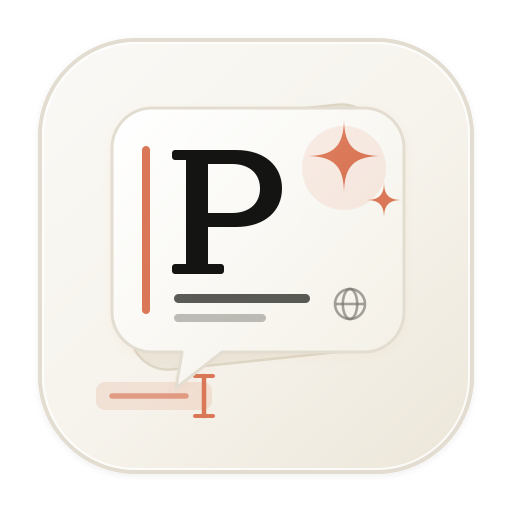
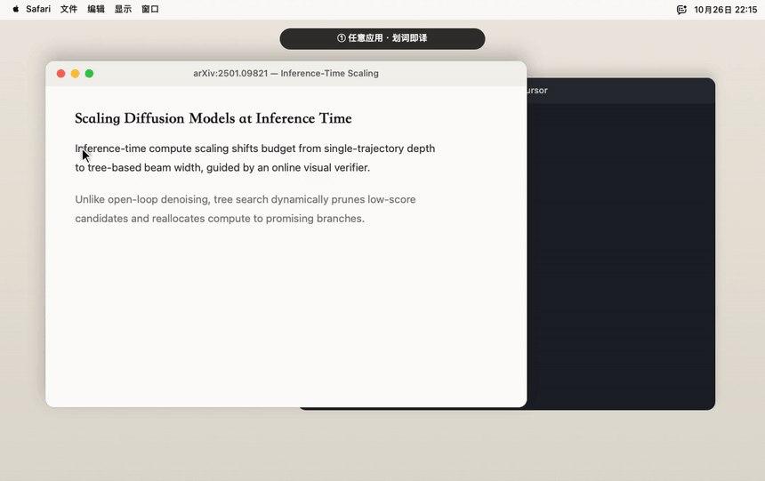

<div align="center">



# popdict

**划词即译 · 截图即解 · 原生丝滑的 macOS 桌面 AI 助手**

选中文字，光标右下角即刻浮现「翻译 / 解释」；按下 `⌃⌥E` 框选屏幕任意区域，让多模态大模型看图精讲。<br>
自带 API Key **直连你选择的模型服务商**，无中间服务器、不中转、不收集任何数据。


<br>

<a href="images/demo.mp4">
  
</a>

</div>

## Core ideas

- **选中即出，精准落位** —— 全局非阻塞监听鼠标划词（优先通过 Accessibility AX API 取词，剪贴板快照无感兜底），无需手动复制或切换应用，快捷悬浮条精确锚定于光标右下角。
- **跨屏框选，看图精讲（`⌃⌥E`）** —— 为每块显示器独立建立全屏遮罩窗口，无论是报错日志、架构图、论文公式还是外文界面，框选即截取高清图像交由多模态模型讲解，并支持在底部输入框连续追问。
- **Claude 暖纸书卷风与块级 Markdown** —— 采用 `#FAF9F5` 暖米白纸感面板与 `#D97757` 赤陶色点缀，自研零依赖块级 Markdown 渲染引擎（衬线标题、赤陶竖条小标题、`✦` 引用类比卡片、圆角暖底代码块、GFM 表格与多级列表），支持 SSE 流式输出、窗口随内容自适应生长与字形级 I-Beam 光标切换。
- **三大主流协议与四大官方预设** —— 原生支持 **OpenAI 兼容**（`/chat/completions`）、**Gemini / Vertex AI 兼容**（`:generateContent` & `:streamGenerateContent?alt=sse`）与 **Anthropic 兼容**（`/v1/messages`）接口协议；内置 **DeepSeek**、**Gemini**（`gemini-3.8-flash`）、**Vertex AI** 与 **MiMo** 四大官方服务商及专属品牌图标，并支持自由增删任意自定义网关。
- **纯粹原生，本机直连** —— 纯 Swift 5 + AppKit 编写（`arm64 + x86_64` Universal Binary），无 Electron 与第三方依赖；API Key 与配置仅存储于本机 `~/.config/popdict/config.json`，划词文本与截图仅在你主动触发时直发所选模型接口。

| 交互场景 | 触发方式 | 行为说明 |
| :--- | :--- | :--- |
| **划词翻译** | 选中文本 → 点击 **「翻译」** | 自动识别源语言并译为「设置 → 语言」中选定的目标语言（默认简体中文） |
| **划词解释** | 选中代码/概念 → 点击 **「解释」** | SSE 流式输出 + 暖纸书卷风完整 Markdown 排版 |
| **多轮追问** | 解释浮窗底部胶囊输入框 → 回车 | 携带当前选中文本或截图上下文连续追问 |
| **截图解释** | 按下全局热键 `⌃⌥E` → 拖拽框选区域 | 调用支持看图的模型（如 Gemini、Vertex AI、MiMo）看图讲解 |
| **语言与 Prompt** | 菜单栏图标 → **「设置… → 语言」** | 统一选择目标回答语言（自动替换 `<languages>` 占位符），并支持自定义翻译与解释 Prompt |

## Get started

1. **安装或源码编译**
   - **直接安装**：前往 [Releases](https://github.com/nanzhi84/popdict/releases) 下载最新 `popdict.dmg`，将 `popdict.app` 拖入「应用程序」文件夹（首次启动请**右键点击图标 → 打开**）。
   - **源码打包**：
     ```bash
     cd popdict-app && bash build.sh
     ```
2. **配置模型服务商与 API Key**
   - 点击屏幕右上角菜单栏 **popdict 图标** → **「设置…」** → **「服务商」**。
   - 在下拉框中直接选择内置服务商（[DeepSeek](https://platform.deepseek.com/) / [Gemini](https://aistudio.google.com/) / [Vertex AI](https://cloud.google.com/vertex-ai) / [MiMo](https://platform.xiaomimimo.com/)）或点击「新增自定义…」，填入 API Key 并点击 **「保存」** 即可立即生效。
3. **开启系统权限与开机自启**
   - 在 **「设置… → 权限」** 页开启 **「辅助功能」**（全局划词监听必需）与 **「屏幕录制」**（`⌃⌥E` 截图解释必需）。
   - 在 **「设置… → 基础」** 页可勾选 **「在开机时启动」**，并查看当前激活的服务商与快捷键概览。

## Learn more

- **工程与架构文档**：
  - [项目定位与开发红线 (PROJECTS.md)](PROJECTS.md)
  - [全局架构现状与核心数据流 (docs/architecture/overview.md)](docs/architecture/overview.md)
  - [构建、安装与自验收手册 (docs/runbooks/build-and-verify.md)](docs/runbooks/build-and-verify.md)
- **架构决策记录 (ADR)**：
  - [ADR-0001：划词气泡与浮窗固定锚定于鼠标光标右下角](docs/adr/0001-cursor-bottom-right-placement.md)
  - [ADR-0002：多协议模型适配层与四大官方服务商预设方案](docs/adr/0002-multi-provider-protocol-adapter.md)
- **版本与开源协议**：
  - [版本变更记录 (CHANGELOG.md)](CHANGELOG.md) · 基于 [MIT License](LICENSE) 开源（仓库同时附带早期轻量实现：[Hammerspoon 脚本](popdict.lua) 与 [PopClip 扩展](DeepSeek-Translate.popclipext)）。
