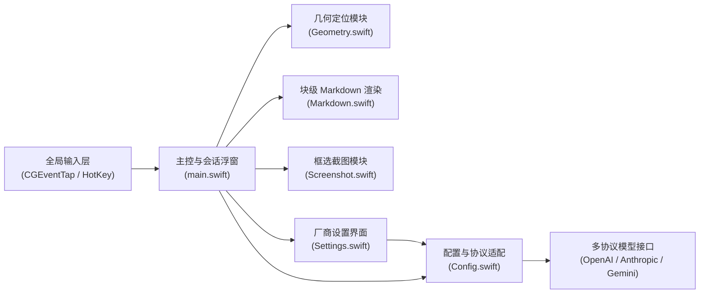
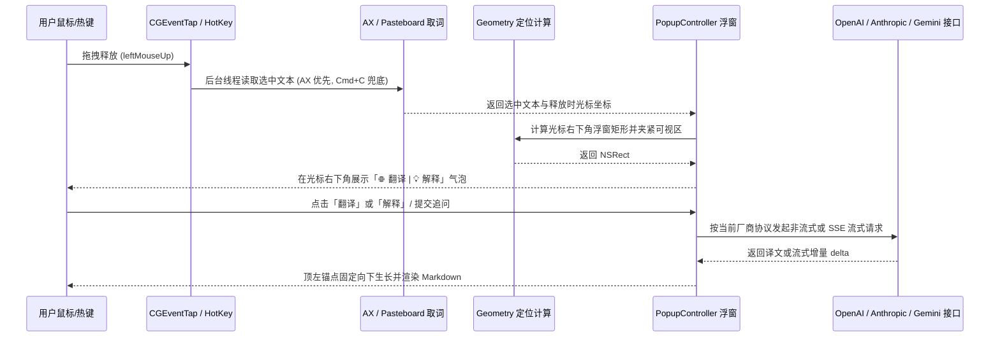

# 全局架构现状 (Architecture Overview)

> 本文件仅维护全局主干（两张 Mermaid 图 + 一组核心约束）。具体子系统或领域细节请在 `docs/architecture/` 下按需平铺新建专题 `.md` 文件。

## 1. 模块边界与源码地图

- **主控与会话浮窗**（[popdict-app/main.swift](../../popdict-app/main.swift)）：负责应用生命周期（`AppDelegate`）、全局鼠标划词监听（`CGEventTap`）、AX/剪贴板取词、翻译与流式对话网络请求（`translate` / `chatStream`）以及毛玻璃浮窗控制器（`PopupController`）。
- **几何定位模块**（[popdict-app/Geometry.swift](../../popdict-app/Geometry.swift)）：纯几何函数层，负责计算划词气泡与浮窗在屏幕可视区内的落点矩形与边界夹紧，不直接耦合 `NSScreen`/`NSEvent`，配套单测位于 [popdict-app/geometry_tests.swift](../../popdict-app/geometry_tests.swift)。
- **块级 Markdown 渲染**（[popdict-app/Markdown.swift](../../popdict-app/Markdown.swift)）：将模型输出的 Markdown（标题、多级列表、GFM 表格、代码块、行内样式）解析为 AppKit `NSAttributedString`，并通过 `CodeBlockLayoutManager` 绘制代码块圆角底色，配套单测位于 [popdict-app/markdown_tests.swift](../../popdict-app/markdown_tests.swift)。
- **框选截图模块**（[popdict-app/Screenshot.swift](../../popdict-app/Screenshot.swift)）：提供全屏遮罩框选（`RegionCapture`）、遮罩下层真实画面截取（`CGWindowListCreateImage`）及 PNG Base64 Data URL 编码。
- **配置持久化与多协议适配**（[popdict-app/Config.swift](../../popdict-app/Config.swift)、[popdict-app/Settings.swift](../../popdict-app/Settings.swift)）：管理多厂商配置列表（`Provider` / `AppConfig`），内置 **DeepSeek**、**Gemini**、**Vertex AI**、**MiMo** 四大官方预设，支持 `OpenAI 兼容`、`Anthropic 兼容`、`Gemini 兼容` 三种协议的请求构造与流式/非流式解析，读写 `~/.config/popdict/config.json`，配套单测位于 [popdict-app/provider_tests.swift](../../popdict-app/provider_tests.swift)。
- **构建与打包脚本**（[popdict-app/build.sh](../../popdict-app/build.sh)）：编译 `arm64 + x86_64` 通用二进制、组装 `popdict.app`、执行代码签名并打包 `popdict.dmg`。

## 2. 核心执行链路与数据流

- **关键数据结构**：
  - `APIFormat`、`Provider` 与 `AppConfig`（定义于 [popdict-app/Config.swift](../../popdict-app/Config.swift)）：描述模型厂商名称、协议格式（`openai` / `anthropic` / `gemini`）、`baseURL`、`apiKey`、`model` 与 `vision` 能力标记。
  - `PopupController` 会话状态（定义于 [popdict-app/main.swift](../../popdict-app/main.swift)）：维护 `convo` 上下文消息数组、`attachedImageDataURL` 多模态图片缓存以及 `generation` 异步回调作废令牌。

## 3. 系统不变量与边界约束

- **事件 Tap 零阻塞与自愈约束**（[popdict-app/main.swift](../../popdict-app/main.swift)）：`CGEventTap` 回调严禁同步休眠或耗时阻塞；取词必须派发至后台队列且由 `gFetchInFlight` 互斥串行化，防止剪贴板快照恢复竞态；遇到 `.tapDisabledByTimeout` 必须立即自愈重开。
- **异步会话代际隔离约束**（[popdict-app/main.swift](../../popdict-app/main.swift)）：每次关闭浮窗、触发新划词或切换「翻译/解释」时，`generation` 令牌必须递增，所有在途的非流式/流式网络回调若 `gen != self.generation` 必须立即丢弃，严禁污染新浮窗。
- **窗口帧动画与尺寸记忆约束**（[popdict-app/main.swift](../../popdict-app/main.swift)）：`frameAnimations > 0` 期间严禁触发 `growToFit()` 或响应 macOS 假 `windowDidEndLiveResize` 回调，防止将动画中间态尺寸写入 `UserDefaults` 或中断自动长高。
- **多屏坐标系翻转基准与分屏独立遮罩约束**（[popdict-app/main.swift](../../popdict-app/main.swift)、[popdict-app/Screenshot.swift](../../popdict-app/Screenshot.swift)）：Quartz（左上原点）与 AppKit（左下原点）之间的 Y 轴翻转必须以原点 `(0,0)` 所在主屏高度 `primaryScreenHeight()` 为基准，严禁使用 `NSScreen.main`（焦点屏）或多屏并集高度；框选截图（`RegionCapture`）必须为 `NSScreen.screens` 中的每块显示器分别创建独立的 `CaptureWindow` 并重写 `constrainFrameRect(_:to:)`，规避 macOS「显示器具有单独的空间」对单窗口跨屏的裁切与 `visibleFrame` 收缩。
